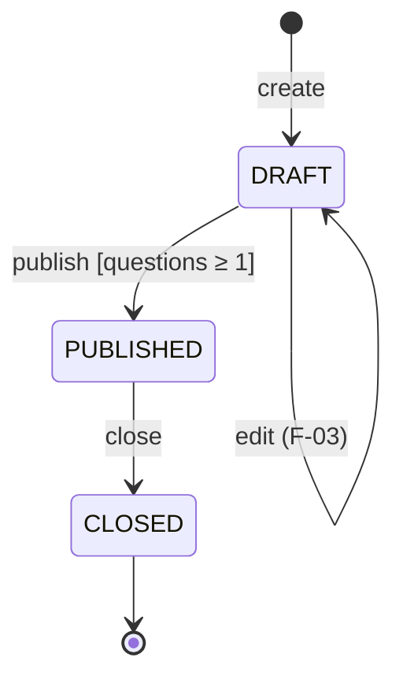

# F-04 Survey lifecycle — Feature contract

| Item | Value |
|---|---|
| Requirements | FR-06, FR-07, BR-04 |
| Depends on | F-03 |
| Version | 1.0 (pre-implementation) |

## Behaviour
State machine (BR-04):

- **Publish**: own survey, status DRAFT, at least one question → status PUBLISHED, `publishedAt = now`.
- **Close**: own survey, status PUBLISHED → status CLOSED, `closedAt = now`.
- Any other transition → 409 `INVALID_TRANSITION` (publish PUBLISHED/CLOSED, close DRAFT/CLOSED).
- Publish with zero questions → 409 `NO_QUESTIONS`.
- The transition check is a pure function `canTransition(from, action)` in `server/src/domain/surveyRules.ts`; the update uses `updateMany where {id, ownerId, status: from}` so two concurrent requests cannot both succeed.

## API
| Method / path | Success | Errors |
|---|---|---|
| POST /api/owner/surveys/:id/publish | 200 `{ "survey": SurveyDetail }` | 401, 403, 404, 409 `INVALID_TRANSITION` / `NO_QUESTIONS` |
| POST /api/owner/surveys/:id/close | 200 `{ "survey": SurveyDetail }` | 401, 403, 404, 409 `INVALID_TRANSITION` |

Data: uses `Survey.status`, `publishedAt`, `closedAt` from F-03 migration; no new tables.

UI: Survey detail shows status badge; **Publish** (DRAFT only, confirm dialog "Published surveys can no longer be edited") and **Close** (PUBLISHED only, confirm dialog). Errors from the API are shown in a banner.

## Acceptance criteria
| ID | Criterion |
|---|---|
| AC-04-01 | Given an own DRAFT survey with ≥ 1 question, when the owner publishes it, then status becomes PUBLISHED and `publishedAt` is set. |
| AC-04-02 | Given an own PUBLISHED survey, when the owner closes it, then status becomes CLOSED and `closedAt` is set. |
| AC-04-03 | Given an own DRAFT survey with 0 questions, when the owner publishes it, then 409 `NO_QUESTIONS` and the status stays DRAFT. |
| AC-04-04 | Publishing a PUBLISHED or CLOSED survey, or closing a DRAFT or CLOSED survey, returns 409 `INVALID_TRANSITION` and the status is unchanged. |

## Definition of Done (feature)
Product DoD plus TEST-04-01…04 and TEST-U-01 pass (TDD: TEST-U-01 committed failing before `canTransition` is implemented).
