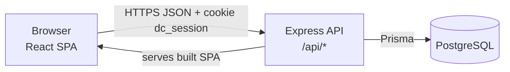
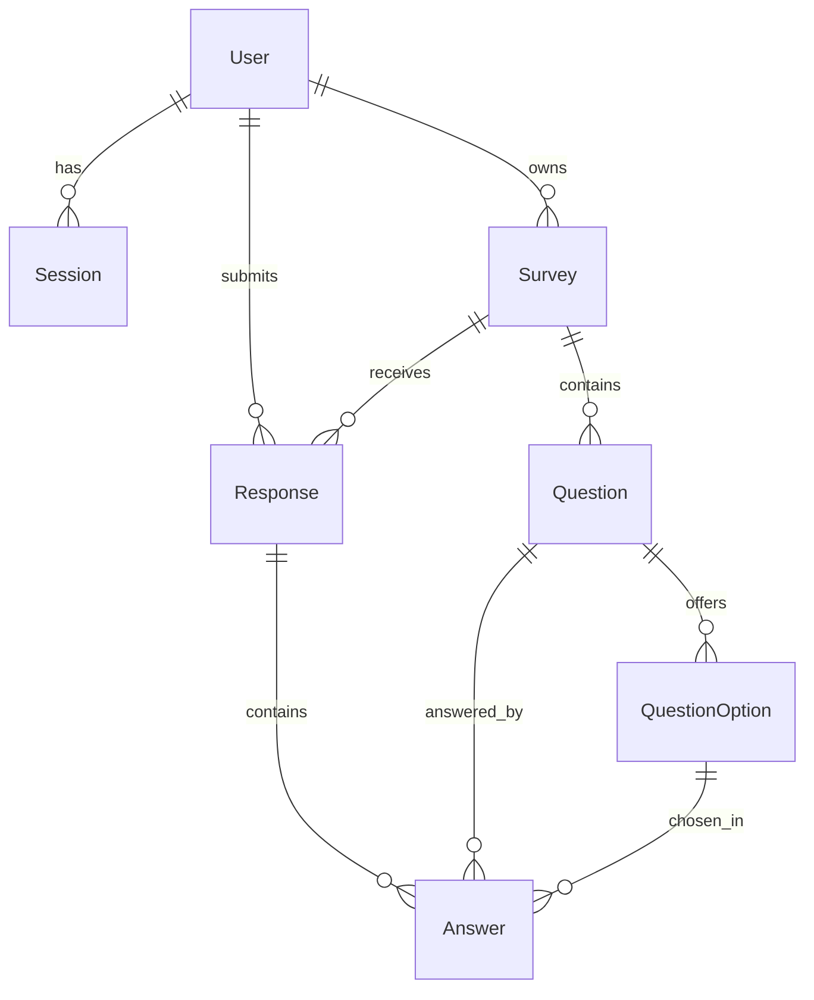

# Donjaicheck — System-Level Software Design Specification (SDS)

Version 1.0 (Sprint 1 baseline). Requirements: [srs.md](srs.md). Features: [features.md](features.md).

## 1. Architecture and stack

| Layer | Technology | Responsibility |
|---|---|---|
| UI | React 19 + TypeScript + Vite, React Router | Screens, client-side form hints, calls the JSON API with `credentials: "include"`. Never decides permissions. |
| API / application | Node.js 24, Express 5, TypeScript | Authentication, role and ownership checks, validation, **all business rules (BR-01…BR-08)**, JSON responses. |
| Data | PostgreSQL 16 via Prisma ORM 7 (`@prisma/adapter-pg` driver adapter) | Persistent storage, migrations, uniqueness and check constraints that back the business rules. |

The team reuses the stack from Labs 1–4 (Node, React, PostgreSQL, Prisma) so the course Starter Kit for Docker, CI and GCP applies directly.



**Communication.** The browser calls `/api/*` with a session cookie. In development Vite (port 5173) proxies `/api` to Express (port 3000). In production one container runs Express, which serves the built SPA and the API on `PORT`.

**Where rules are enforced.** Every rule is enforced in the API layer (`server/src/domain/*` pure functions + route handlers). The database adds a second line of defence: unique `(surveyId, respondentId)` on `Response` (BR-01) and a CHECK `ratingValue BETWEEN 1 AND 5` (BR-03). The UI only mirrors validation for usability.

**Code layout.**
```
server/
  prisma/schema.prisma, migrations/, seed.ts
  src/app.ts            Express app (routes, JSON, cookie, CSRF check, static SPA)
  src/index.ts          reads PORT, starts server
  src/lib/              auth.ts (hash, token), errors.ts
  src/middleware/       requireAuth, requireRole, csrfCheck
  src/domain/           surveyRules.ts, responseRules.ts, summary.ts (pure, unit-tested)
  src/routes/           auth.ts, owner.ts, respondent.ts, health.ts
  tests/                unit/, api/ (Vitest + Supertest against a test DB)
client/src/             pages/, components/, api.ts, auth context
e2e/                    Playwright journeys
```

## 2. Data model



| Entity | Key fields | Constraints / notes |
|---|---|---|
| User | id, name, email, passwordHash, role (`SURVEY_OWNER` \| `RESPONDENT`), createdAt | email unique (lower-cased); passwordHash bcrypt |
| Session | tokenHash (PK), userId → User, createdAt, expiresAt | cascade delete with user; index on expiresAt |
| Survey | id, ownerId → User, title, description, status (`DRAFT` \| `PUBLISHED` \| `CLOSED`), createdAt, updatedAt, publishedAt?, closedAt? | ownership link for BR-06; status changes only via lifecycle endpoints (BR-04) |
| Question | id, surveyId → Survey, position, text, type (`RATING` \| `SINGLE_CHOICE` \| `TEXT`), required | unique (surveyId, position); cascade delete with survey |
| QuestionOption | id, questionId → Question, position, label | unique (questionId, label) |
| Response | id, surveyId → Survey, respondentId → User, submittedAt | **unique (surveyId, respondentId)** — BR-01 |
| Answer | id, responseId → Response, questionId → Question, ratingValue?, optionId? → QuestionOption, textValue? | unique (responseId, questionId); CHECK ratingValue 1–5 |

**Database setup.** `prisma migrate deploy` applies committed migrations (`init`, `surveys`, `responses`); migrations only add tables/columns so an older image still works after a rollback (Lab 5). The `responses` migration adds a hand-written CHECK constraint `Answer_ratingValue_range` (1–5). `npm run prisma:seed` is idempotent (existing users and surveys are kept) and creates 2 owners (password `ADMIN_PASSWORD`); when `SEED_DEMO_DATA=true` it also creates 3 respondents (password `DEMO_USER_PASSWORD`), one published sample survey ("Dinner experience at Donjai Siam") and one draft. The seed stops with an error if a required password variable is missing.

## 3. UI structure and conventions

| Screen | Route | Role |
|---|---|---|
| Login | `/login` | public |
| My surveys (list, status, response count) | `/owner/surveys` | SURVEY_OWNER |
| Survey editor (create / edit draft) | `/owner/surveys/new`, `/owner/surveys/:id/edit` | SURVEY_OWNER |
| Survey detail (questions, Publish / Close) | `/owner/surveys/:id` | SURVEY_OWNER |
| Summary | `/owner/surveys/:id/summary` | SURVEY_OWNER |
| Available surveys | `/surveys` | RESPONDENT |
| Answer survey | `/surveys/:id` | RESPONDENT |
| Confirmation / my response | `/responses/:id` | RESPONDENT |

Shared behaviour: a header shows the user's name, role and **Log out**. After login the user is routed by role. Every page uses shared `Loading`, `EmptyState` and `ErrorBanner` components (NFR-06). Forms show the API's field errors next to the field; required fields are marked `*`. Buttons that the role may not use are hidden, **but hiding is never the protection**: the API rejects them (F-02).

## 4. API approach

- JSON over `/api`, nouns in plural, actions on lifecycle use sub-resources: `POST /api/owner/surveys/:id/publish`.
- Owner endpoints live under `/api/owner/*` (role `SURVEY_OWNER`); respondent endpoints under `/api/surveys` and `/api/responses` (role `RESPONDENT`).
- State-changing requests must send header `X-Requested-With: Donjaicheck` (CSRF defence together with SameSite=Lax cookie); otherwise 403 `CSRF_REJECTED`.
- Success: 200 (read/update), 201 (create), 204 (logout).
- **Error shape** (never includes stack traces or other users' data):
  ```json
  { "error": "Human readable message", "code": "MACHINE_CODE", "details": [{ "field": "questions[0].text", "message": "Required" }] }
  ```
- Codes: 400 `VALIDATION_FAILED`, 401 `UNAUTHENTICATED`/`INVALID_CREDENTIALS`, 403 `FORBIDDEN`/`CSRF_REJECTED`, 404 `NOT_FOUND`, 409 `ALREADY_RESPONDED`/`SURVEY_NOT_OPEN`/`INVALID_TRANSITION`/`SURVEY_NOT_EDITABLE`/`NO_QUESTIONS`, 500 `INTERNAL_ERROR`.
- Health: `GET /api/health` → `{status:"ok"}`; `GET /api/ready` → `{status:"ready", db:"connected"}` or 503.

Detailed endpoint contracts are in the Sprint 1 feature contracts.

## 5. Roles, ownership and permission matrix

| Operation | Endpoint | Anonymous | RESPONDENT | SURVEY_OWNER |
|---|---|---|---|---|
| Login | POST /api/auth/login | ✅ | ✅ | ✅ |
| Logout / me | POST /api/auth/logout, GET /api/auth/me | 401 | ✅ | ✅ |
| List own surveys | GET /api/owner/surveys | 401 | 403 | ✅ own only |
| Create survey | POST /api/owner/surveys | 401 | 403 | ✅ (becomes owner) |
| Read / edit draft | GET, PUT /api/owner/surveys/:id | 401 | 403 | ✅ own only, else 404 |
| Publish / close | POST /api/owner/surveys/:id/publish, /close | 401 | 403 | ✅ own only, else 404 |
| Summary | GET /api/owner/surveys/:id/summary | 401 | 403 | ✅ own only, else 404 |
| List published surveys | GET /api/surveys | 401 | ✅ | 403 |
| Read published survey | GET /api/surveys/:id | 401 | ✅ PUBLISHED/CLOSED only | 403 |
| Submit response | POST /api/surveys/:id/responses | 401 | ✅ once (BR-01/02/03) | 403 |
| Read response | GET /api/responses/:id | 401 | ✅ own only, else 404 | 403 |

Ownership is enforced in the query itself (`where: { id, ownerId: currentUser.id }`), so another owner's survey is indistinguishable from a missing one (D-07).

## 6. Authentication and session lifecycle

1. **Login** — `POST /api/auth/login {email, password}`. Email is trimmed and lower-cased. The password is compared with the bcrypt hash (cost from `BCRYPT_COST`, minimum 10). Wrong email or wrong password returns the same 401 `INVALID_CREDENTIALS`.
2. **Session creation** — a 256-bit random token is generated; only its SHA-256 hash is stored in `Session` with `expiresAt = now + SESSION_TTL_HOURS` (default 8). The raw token is sent once in cookie `dc_session` (`HttpOnly`, `SameSite=Lax`, `Secure` in production, `Path=/`).
3. **Current user** — `requireAuth` hashes the cookie token, loads the session and user, rejects missing/expired sessions with 401 and deletes expired rows. `GET /api/auth/me` returns `{id, name, email, role}` (never the hash).
4. **Logout** — deletes the session row and clears the cookie; the old token then returns 401.
5. **Passwords** — never logged, never returned, never stored in plaintext (NFR-01).

## 7. Configuration and secrets

| Variable | Purpose | Secret | Local source | Cloud source (Lab 5) |
|---|---|---|---|---|
| DATABASE_URL | PostgreSQL connection | Yes | `server/.env` | Secret Manager |
| TEST_DATABASE_URL | Test DB (name must end `_test`) | No (local) | `server/.env` | not used (CI uses its throw-away `DATABASE_URL`) |
| PORT | HTTP port | No | default 3000 | set by Cloud Run |
| NODE_ENV | `development` / `production` / `test` | No | `.env` | Cloud Run env var |
| SESSION_TTL_HOURS | Session lifetime | No | default 8 | env var |
| BCRYPT_COST | bcrypt cost (≥ 10) | No | default 10 | env var |
| ADMIN_PASSWORD | Initial password of the seeded survey owners | Yes | `.env` (your own value) | Secret Manager (generated) |
| DEMO_USER_PASSWORD | Password of the seeded demo respondents | Yes | `.env` (your own value) | Secret Manager (generated) |
| SEED_DEMO_DATA | Create demo respondents and sample surveys | No | `true` | `true` for the Lab 6 UAT demo |

`.env` is in `.gitignore`; only `.env.example` with placeholders is committed. No secret is placed in client code (Vite only exposes `VITE_*` variables, none of which are secret).

## 8. Deployment design (implemented in Lab 5)

- **Docker**: one multi-stage image — build client, build server, runtime stage with server `dist`, `prisma/`, production `node_modules` and client `dist`; runs as non-root on `PORT`.
- **GCP**: Artifact Registry (images tagged with commit SHA) → Cloud Run service (min 0, max 3 instances) → Cloud SQL for PostgreSQL 16 via Unix socket; secrets in Secret Manager; migrations run as a separate Cloud Run job before the service update.
- **CI/CD**: GitHub Actions runs tests and Docker build on every PR into `staging` and `main`; a ruleset makes the check required; merging into `main` deploys through Workload Identity Federation (no JSON keys).
- **Durability**: no file or session is stored in the container; everything lives in PostgreSQL (NFR-04).

## Version history

| Version | Date | Change | Author |
|---|---|---|---|
| 1.0 | 2026-11-13 | Initial system design for Sprint 1 baseline | Team EN-020 T&T |
| 1.1 | 2026-11-14 | Implementation alignment: Prisma 7 with the pg driver adapter; seed variables `ADMIN_PASSWORD`, `DEMO_USER_PASSWORD`, `SEED_DEMO_DATA` replace `SEED_PASSWORD` (same names as the Lab 5 Starter Kit); `CLIENT_ORIGIN` removed because the Vite dev proxy and the production build are same-origin; `summary.ts` added to the domain layer. | Team EN-020 T&T |
